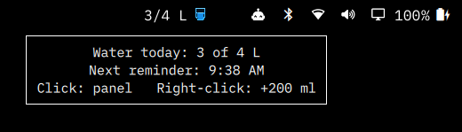
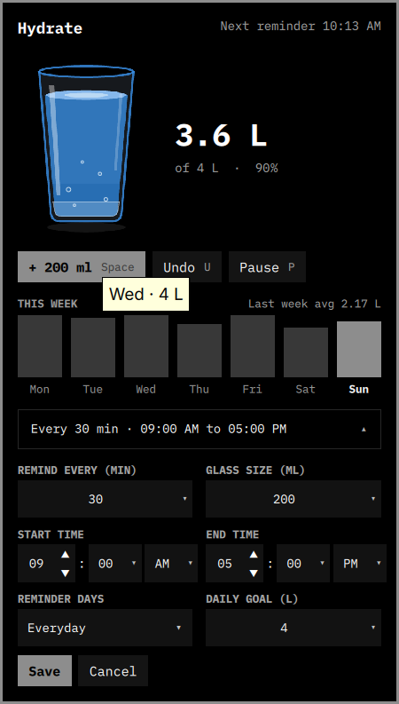

# 🥤 Hydrate — Water Reminder & Intake Tracker for Linux

> _Vibe-coded water reminder and intake tracker for Linux desktops._

Hydrate helps you keep track of how much water you drink throughout the day. It runs quietly in the background, reminds you to drink water, and lets you monitor your progress directly from the desktop panel.

---

## ✨ Features

- **Dynamic Menu Bar Icon:** A sharp, custom vector glass that fills with blue water as you drink, alongside your live intake counter (e.g. `1.5/2.5 L`).
- **Interactive Panel:** View your daily progress, animated glass, weekly history and settings.
- **Weekly Statistics:** Current calendar week (Monday–Sunday), with an optional Monday–Friday view.
- **Previous Week Average:** See your average daily intake from the previous week.
- **Chart Tooltips:** Hover over a day's bar or label to see its exact water intake.
- **Quick Water Logging:** Log a glass, undo an entry, or pause and resume reminders.
- **Custom Reminders:** Choose your reminder interval, start/end time and reminder days.
- **Flexible Settings:** Set your daily goal between 2–6 L and glass size between 200–400 ml.
- **Local Storage:** Your intake history and settings stay on your machine.
## 🖥️ Desktop Integration

| Desktop / Bar        | Integration                                  |
| -------------------- | -------------------------------------------- |
| Omarchy / Quickshell | Native menu bar widget and interactive panel |
| Waybar               | Status module with quick water logging       |
| Other Linux desktops | CLI and application launcher                 |

The Omarchy integration is the primary Hydrate experience.

<table align="center">
<tr valign="top">
<td align="center">

<br>
<em>Live Bar Widget with Progress</em>
</td>
<td align="center">

<br>
<em>Flyout Panel with 7-Day History & Accordion Settings</em>
</td>
</tr>
</table>

---
## 🚀 Installation

Download and extract the repository:

```
git clone https://github.com/TejaNune1998/hydrate-linux.git
cd hydrate-linux
chmod +x install.sh
./install.sh
```

The installer detects your desktop environment and available package manager.

### Installation options

* Force Quickshell integration
```
./install.sh --quickshell
```

* Force Waybar integration
```
./install.sh --waybar
```

* Skip Quickshell or Waybar
```
./install.sh --no-quickshell
./install.sh --no-waybar
```

* Check installation
```
hydrate doctor
```


## 🎮 Usage

### Menu Bar Controls

| Action      | Result                               |
| ----------- | ------------------------------------ |
| Hover       | View intake and reminder information |
| Left-click  | Open Hydrate panel                   |
| Right-click | Log one glass of water               |

### Keyboard Shortcuts

Inside the Omarchy panel:

- `Space` — Log one glass
- `U` — Undo last entry 
- `P` — Pause / Resume reminders
  

### CLI Commands

* Water tracking
```
hydrate log
hydrate undo
hydrate reset
```

* Statistics
```
hydrate status
hydrate stats
```

* Reminders
```
hydrate pause
hydrate resume
hydrate alert
```

* Open panel
```
hydrate panel
```

* Check installation
```
hydrate doctor
```

## ⚙️ Settings

Hydrate's settings can be managed from the interactive panel or CLI.

| Setting            | Available options              |
| ------------------ | ------------------------------ |
| Reminder interval  | 30 / 45 / 60 minutes           |
| Start and end time | 12-hour AM/PM controls         |
| Time minutes       | 00 / 15 / 30 / 45              |
| Reminder days      | Everyday / Weekdays            |
| Glass size         | 200 / 250 / 300 / 350 / 400 ml |
| Daily goal         | 2–6 L (0.5 L increments)       |

The time picker uses hour increase/decrease buttons and separate minute and AM/PM dropdowns. Changes are applied using **Save** or discarded using **Cancel**.

### Configuration

Stored at:

```
~/.config/hydrate/config
```

### Intake History

Daily intake is stored locally in millilitres:

```
~/.local/state/hydrate/
├── 2026-11-06.ml
├── 2026-11-07.ml
└── ...
```

Each file represents one day's total water intake. No account or cloud service is required.

## 🔔 Reminders

Hydrate uses a user-level systemd timer to check when your next reminder is due.

- Reminders follow your configured schedule.
- Clicking a reminder logs one glass.
- Dismissing a reminder snoozes it for 10 minutes.
- Reminders stop once your daily goal is reached.
- You can pause and resume reminders whenever needed.

## 🔧 Troubleshooting

* Check Hydrate installation

```
hydrate doctor
```

* Check reminder timer

```
systemctl --user list-timers hydrate.timer
```

* View reminder logs

```
journalctl --user -u hydrate.service -n 20 --no-pager
```

* Omarchy widget not showing

```
omarchy plugin enable hydrate right
omarchy-restart-shell
```

## 🗑️ Uninstallation

* Remove Hydrate but preserve settings and history
```
hydrate uninstall
```

* Remove everything, including settings and history
```
hydrate purge
```

## 🐧 Distribution Support

| Distribution          | Package Manager | Status              |
| --------------------- | --------------- | ------------------- |
| Arch Linux / Omarchy  | `pacman`        | Tested ✅            |
| Debian / Ubuntu       | `apt`           | Supported, untested |
| Fedora / RHEL / Rocky | `dnf` / `yum`   | Supported, untested |
| openSUSE              | `zypper`        | Supported, untested |

## 📄 License

This project is licensed under the [MIT License](LICENSE).
